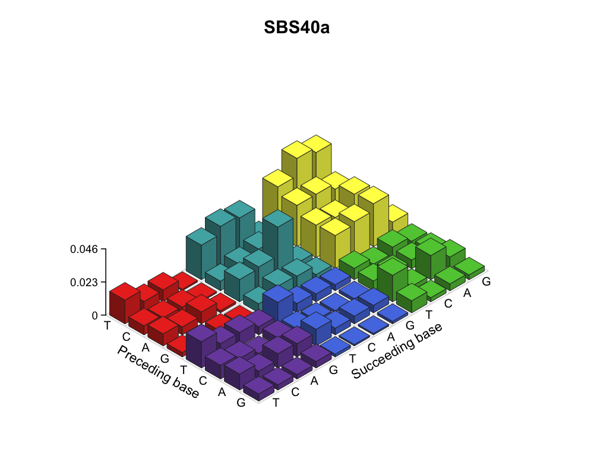
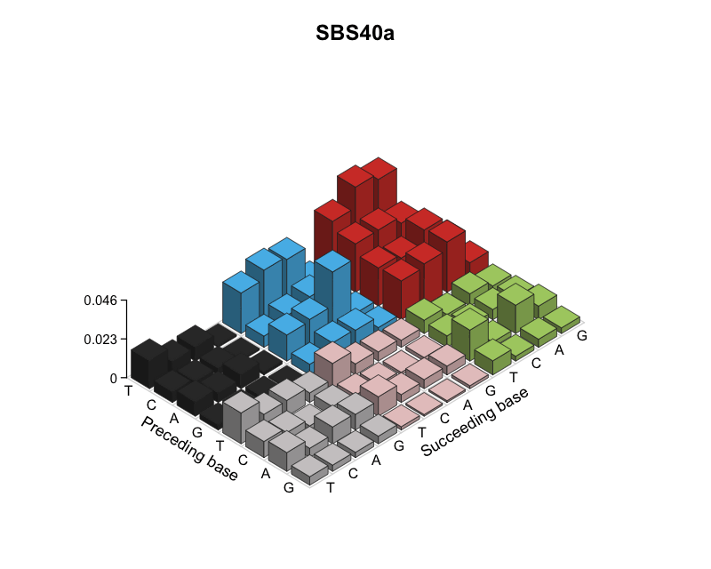

# legoplots

Draws the 96-trinucleotide-context mutational spectrum of a sample or
signature as a "lego plot" — a 3D-style bar plot, in the layout convention
as an alternative to the flat 2D spectrum plots used by COSMIC/Sanger.
The 3D style helps one to see context patterns more easily. 

## Installation

Install the package from a local checkout:

```r
install.packages(".", repos = NULL, type = "source")
```
Alternatively
```r
devtools::install_github("NCI-CGR/legoplots")
```

For development, `devtools::load_all()` also works if devtools is installed.

## Quick start

```r
library(legoplots)

cosmic <- read_sigprofiler_sbs96("COSMIC_v3.6_SBS_GRCh38.txt")

legoplot3d(cosmic, sample = "SBS40a", labels = TRUE,
           zsub = "Probability", main = "COSMIC SBS40a",
           outfile = "SBS40a.pdf")
```



This works identically whether you run it in RStudio, from `Rscript` on a
server with no display, or inside a Docker container — `outfile` just opens
a `png()`/`pdf()`/`svg()` device (chosen from the file extension), draws,
and closes it.

## Implementation

`legoplots` projects each 3D bar onto 2D and draws it with
`graphics::polygon()`. Base R's
`png()`/`pdf()` devices need no OpenGL, no X11, no headless-Chrome shim, and
no architecture-specific binaries. They work the same on x86_64 or arm64,
locally or in a minimal container.

## API

- `context96` — the embedded 96-context lookup table (`context`, `label`,
  `order`, `substitution`, `preceding`, and `succeeding`).
- `lego_palette(sixcolors)` — `"broad"` / `"sanger"` / `"mike"`, or your own
  vector of 6 R colors (order: C>A, C>G, C>T, T>A, T>C, T>G).
- `resolve_context_values(contextdata)` — matches a named or positional
  input vector against `context96`; errors clearly on unrecognized names
  instead of silently mis-plotting.
- `compute_lego_layout(contextdata, sixcolors)` — pure data step: returns a
  data frame of grid position, value, and color per context. No graphics.
- `render_lego3d(layout, ...)` — draws a layout data frame. Options include
  `gap`, `zscale`/`zmax` (fix `zmax` across multiple calls to keep the
  vertical scale comparable when plotting several signatures side by side),
  `labels`, `zlabels`, `zsub`, `gridlines`, `main`, face-shading factors,
  and `outfile`/`width`/`height`/`res`.
- `legoplot3d(contextdata, ...)` — the convenience wrapper: layout + render
  in one call, with the combined parameter set above. Selecting multiple
  samples plots them side by side with a shared vertical scale; set
  `free_z = TRUE` to scale each panel independently.
- `legoplot3d_sbs288(contextdata, ...)` — splits one SBS288 sample into its
  U, T, and N strand channels and plots the three SBS96 panels side by side.
- `animate_legoplot3d(contextdata, ...)` — renders a gently moving camera path
  as an animated GIF.
- `read_sigprofiler_sbs96(x)` — imports SigProfiler SBS96 files, matrices, or
  data frames and returns a context-by-sample matrix.

## Animated GIFs

Static plots use only base R. Animated GIF encoding requires the optional,
single-purpose `gifski` package; ImageMagick and command-line tools are not
required.

```r
install.packages("gifski")

animate_legoplot3d(
  cosmic,
  sample = "SBS40a",
  outfile = "legoplot.gif",
  n_frames = 48,
  fps = 12,
  azimuth_amplitude = 15,
  elevation_amplitude = 7,
  labels = TRUE,
  zsub = "Probability"
)
```



The camera follows a closed elliptical path, so the animation loops without
repeating the first frame at the end. It uses an orthographic projection that
does not introduce elevation-dependent zoom. Temporary PNG frames are deleted
even if rendering or encoding fails.

## SigProfiler Suite

SigProfilerMatrixGenerator and SigProfilerExtractor SBS96 matrices can be
plotted directly. Select a sample or signature when the file has more than
one numeric column:

```r
legoplot3d(
  "output/SBS/project.SBS96.all",
  sample = "Sample1",
  labels = TRUE,
  zsub = "Mutation count",
  outfile = "Sample1.pdf"
)
```

You can also import once and reuse the resulting matrix:

```r
sbs96 <- read_sigprofiler_sbs96("output/SBS/project.SBS96.all")
legoplot3d(sbs96, sample = "Sample1")
legoplot3d(sbs96, sample = c("Sample1", "Sample2"))
legoplot3d(sbs96, sample = c("Sample1", "Sample2"), ncol = 1)
legoplot3d(sbs96, sample = c("Sample1", "Sample2"), free_z = TRUE)
legoplot3d(sbs96, sample = c("Sample1", "Sample2"),
           mar = c(1, 1, 3, 1), main_line = -1)
```

The importer accepts `MutationType` and `Mutation Types` context columns,
contexts stored as row names, transposed matrices with contexts as columns,
and files containing separate substitution and trinucleotide columns.
Strand-prefixed contexts are collapsed to SBS96 by summing strands.

## SBS288 strand plots

Use `legoplot3d_sbs288()` to compare the untranscribed, transcribed, and
non-transcribed channels of one SBS288 sample:

```r
legoplot3d_sbs288(
  "output/SBS/project.SBS288.all",
  sample = "Sample1",
  labels = TRUE,
  zsub = "Mutation count",
  outfile = "Sample1_SBS288.png"
)
```

Rows may use strand-prefixed labels such as `U:A[C>A]A`, or separate U/T/N
and SBS96 context columns. The panels use a shared vertical scale by default;
pass `free_z = TRUE` for independent scales.

## Input format

Named vectors are strongly preferred over positional ones — position-based
input silently produces a wrong-but-plausible-looking plot if it's ever in a
slightly different order than expected, whereas a name typo raises an error.
Two naming schemes are accepted:

- Standard SBS96 notation, e.g. `"A[C>A]A"` (matches COSMIC / SigProfiler /
  MutationalPatterns) — see `context96$context`.
- `sigdata1.txt`-style labels, e.g. `"C>A|G>T_AxA"` — see `context96$label`.

An unnamed numeric vector of exactly 96 elements is still accepted, and must
be in `context96`'s row order (the standard order used throughout
`sigdata1.txt`).

## Tests

```sh
R CMD check .
```

This checks package metadata, examples, layout logic, name matching, and PNG
rendering.
